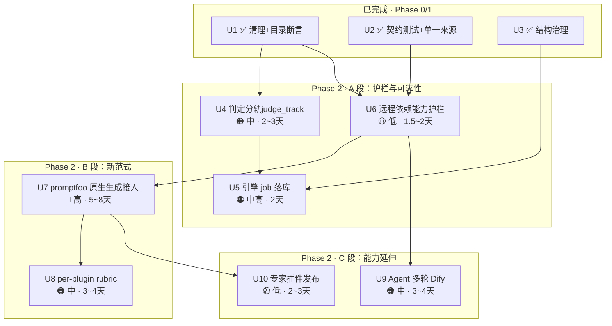

# 14 · Phase 2 实施计划（U4~U10 可执行批次）

> 项目：LLM / Agent 红队安全评测平台（evaluating_platform）
> 编制：软件架构师 高见远（Gao）｜日期：2026-10-10
> 性质：把 `03-重构与开发计划.md` 的 Phase 2（T2.1/T2.2/T2.3/T2.4）排成**可执行批次**，并把Phase 1 遗留的 U4/U5 一并纳入**同一条编号序列**，避免两套编号并存。
> 依据：`06-用户确认决策记录.md`（决策台账，**实施以该文件为准**）、`08-统一执行计划.md`（U1~U5，Phase 0/1 执行版）、`09-迭代进展与现状.md`（已完成状态）、`13-U3验收报告.md`（纪律与DoD 格式）、`04-关键技术与决策细节.md`（技术细节）。
> **本阶段只产出 Markdown，不改业务代码。**

---

## 0. 承接状态（Phase 0/1 已交付）

| 批次 | 主题 | 状态 |
|---|---|---|
| Phase 0（T0.1/T0.2/T0.3） | 治理与止血 | ✅ 完成 |
| **U1** | 零风险清理 + 目录一致性断言 + 死表登记 | ✅ 完成并合并 `main` |
| **U2** | 契约测试 + 引擎分类单一来源 + plugin_id 归一 + 前端 vitest | ✅ 完成并合并 `main` |
| **U3 / U3-b** | 结构治理（拆 `redteam` 子包 + `client.go` 分层） | ✅ Step 1~4 完成，Step 6 验收通过（`origin/main = a69eeea`） |
| **U4 / U5** | 判定分轨/ 引擎 job 落库 | ⬇️ **本文件纳入 Phase 2 序列，一并排期** |
| U6~U10 | Phase 2 能力建设 | ▶ 本文件排期对象 |

**基线事实（2026-10-10 实测，本计划全部以此为准）**：

| 事实 | 值 | 证据 |
|---|---|---|
| Go 工具链 | `/Users/huangqixu/sdk/go/bin/go`（go1.25.5 darwin/arm64） | `09` §6.1 |
| Docker | **本机无** → compose 验证以 CI 为准 | `09` §6.1 |
| 插件目录 | `internal/maclaw/promptfoo_plugin_catalog.go`：**119 插件**（L86-219）/ **30 策略**（L220-267），条目为 `p("id","名称","分类","摘要","严重度")` / `s("id","名称","摘要")` 构造器 | 实测 |
| 引擎现有生成 | `promptfoo_engine/src/runner/generateTests.ts` **仅 189 行**，头注释写明「Plan A：引擎自己合成攻击 prompt，promptfoo 只在 evaluate 模式消费；它自己的 redteam generation 从不参与」 | 实测 |
| 引擎主运行 | `src/runner/redteamRun.ts` 496 行 | 实测 |
| fail-closed 守卫 | `promptfoo_engine/src/env.ts:34-50` `assertSecuritySwitches()`，**4 个开关缺一即拒启动** | 实测 |
| 单一 rubric | `SAFETY_RUBRIC` 定义于 `redteamRun.ts:199`，挂载于 `:262`，**全插件共用一条** | 实测 |
| 引擎请求体 | `EngineRunRequest`（`internal/maclaw/promptfoo_engine_client.go:79`）：`purpose` / `num_tests` / `plugins` / `strategies` / `judge_mode` / `credentials` / `catalog` | 实测 |
| promptfoo | `0.123.0`，`runRedteam()` 由主入口导出（`dist/src/index.js:19058`） | 实测 |

---

## 1. 批次划分总表

**排序原则（硬性）**：**先补护栏与可见性（不依赖新功能）→ 再做可靠性→ 再接新范式（高风险）→ 最后生态**。
每批 = 一个可独立回滚的提交序列，遵循 `08` §5 迭代协议（实现 → 本地全绿 → 提交 → 推送 → CI 绿 → 下一批）。

| 批次 | 主题 | 前置| 风险 | 预估 | 来源 |
|---|---|---|---|---|---|
| **U4** | 判定分轨（`judge_track` 字段 + 报告脚注） | 无 | 🟠 中 | 2~3 天 | `04` DD-2=A / DD-5=A |
| **U5** | 引擎 job 落库（`pfj-` → PostgreSQL） | U3 | 🟠 中高 | 2 天 | `04` DD-6=A（已确认执行） |
| **U6** | **远程依赖能力护栏**（目录标记 + 前端可见 + 明确报错） | U1 | 🟡 低 | 1.5~2 天 | **本轮新发现** |
| **U7** | **promptfoo 原生生成接入（DD-1 = C 落地）** | U6 | 🔴 高 | 5~8 天 | `03` T2.1b / `06` D-12 |
| **U8** | 插件驱动判定（per-plugin rubric） | U7 | 🟠 中 | 3~4 天 | `03` T2.1c + T2.3 |
| **U9** | Agent 多轮（Dify + `conversation_id`） | 无（可并行） | 🟠 中 | 3~4 天 | `03` T2.2 / `06` D-04 |
| **U10** | 专家自定义插件发布链路 | U7 | 🟡 低 | 2~3 天 | `03` T2.4 / `06` D-03 |

### 1.1 为什么把 U6 排在 U7 之前（排序理由）

采纳主理人建议，理由三条：

1. **护栏先于功能，是本项目已沉淀的纪律**。U3 的验收报告明确写了「静默失败」是本项目最难防的失效模式（`13` §纪律 5）。`createRemotePlugin()` 在远程关闭时**只写一条 `logger.error` 然后 `return []`**——不抛错、不中断、不影响退出码。若 U7 先落地，那么"评测跑完、报告出来、某插件覆盖 0"会在**用户第一次用原生生成时**就发生，且**当时没有任何护栏**告诉他们。先做 U6，等于先装好仪表盘再开高速。
2. **U6 是 U7 的验收前提，不是并行项**。U7 的核心交付物之一就是"远程依赖项被屏蔽且**用户可见**"；如果目录层没有 `requires_remote_generation` 标记这个字段，U7 根本无处安放这个信息。U6 先做，U7 只需接上生成逻辑。
3. **成本极低、收益跨批次**。U6 是纯目录元数据 + 前端展示（不碰生成逻辑），🟡 低风险、1.5~2 天；而它同时**提前封堵**了"将来任何路径碰到 `createRemotePlugin` 就会中招"的隐患——包括不在本计划内的路径。

### 1.2 依赖图



> **U9 可与A 段并行**（Agent 多轮与promptfoo 原生生成无耦合，仅依赖 U6 的护栏以免多轮策略踩到远程依赖项）。

---

## 2. 各批次详细设计

### U4 · 判定分轨显式化（`judge_track`）

| 维度 | 内容 |
|---|---|
| **批次目标** | 报告按**本次实际链路**显示判定口径，加`judge_track` 字段 + 页脚注说明两套口径差异；安全分按所选模式计算。承接 `04` DD-2=A（分列 + 脚注）、DD-5=A（复用同一 schema + `engine` 字段）。 |
| **前置依赖** | 无（U1/U2 已让两侧 category/severity 同源，报告口径才可对齐） |
| **涉及文件** |改：`internal/maclaw/redteam_artifact_service.go`（报告 schema + `reportSections`）、`internal/maclaw/promptfoo_engine_bridge.go`（写入 `judge_track=engine`）、`internal/maclaw/redteam_bridge.go`（写入 `judge_track=platform`）；报告前端组件（报告卡 + PDF 页脚）；`evaluating_platform/docs/architecture/*` |
| **关键实现要点** | ① 报告 schema 增 `judge_track`（`platform` \| `engine`），**向后兼容**：旧报告该字段为空时按 `metadata.engine` 推断，不报错；② 报告卡与 PDF **页脚**加一句口径说明（不是正文，避免污染结论）；③ **不引入统一评分**（明确不做 DD-2 的 C 方案，避免过早收敛）；④ 与 U3-b 已做的 `artifact_service`/`llm_judge` 分层对齐，改动落在新分层位置。 |
| **验收标准** | ① 同一目标分别走两条链路，报告 `judge_track` 与分数口径**自洽**；② PDF 渲染正常（`redteam_report_pdf_layout_v2`）；③ 旧报告（字段为空）仍可渲染；④ 覆盖率不降（见 §4纪律） |
| **可执行验收** | ```bash<br>cd evaluating_platform && /Users/huangqixu/sdk/go/bin/go build ./... && /Users/huangqixu/sdk/go/bin/go test ./...<br>cd frontend && npm run build && npm test``` |
| **风险等级** | 🟠 中（触及报告渲染） |
| **预估工作量** | 2~3 天 |
| **回滚方式** | 单commit `feat(U4): ...`；`git revert` 即回滚；schema 字段为 `omitempty`，回滚后旧数据不受影响 |
| **DoD** | - [ ] `go build ./... && go test ./...` 全绿<br/>- [ ] `npm run build && npm test` 全绿<br/>- [ ] 两条链路各跑一次，报告 `judge_track` 正确<br/>- [ ] 旧报告（无该字段）可正常渲染（**实测**，非推断）<br/>- [ ] PDF 页脚口径说明已渲染<br/>- [ ] 覆盖率只升不降（`-coverpkg` 口径，被覆盖语句块数 ≥ U3 基线）<br/>- [ ] 护栏反证测试：手工把某报告的 `judge_track` 改成非法值 → 应报错而非静默通过<br/>- [ ] 一个语义化commit 已推送，CI 5 job 全绿 |

---

### U5 · 引擎 job 落库（`pfj-` → PostgreSQL）

| 维度 | 内容 |
|---|---|
| **批次目标** | confirm fast path 的 `pfj-` 内存 job 也写 PostgreSQL（`engine_runs`，加 `source=chat_confirm`），BFF 重启后前端进度可恢复。承接 `04` DD-6=A（`06` D-11 用户已确认"可以有"= 执行）。 |
| **前置依赖** | U3（结构就位）、U4（报告语义就位） |
| **涉及文件** | 改：`internal/maclaw/engine_job_store.go`、`engine_confirm.go`、`engine_run_service.go`；增：`migrations/027_*.sql`（如需新增字段，**顺延不得插队**） |
| **关键实现要点** | ① `engine_runs` 加 `source` 字段区分 `chat_confirm` 与自选评测；② 内存态与 PG 态的**写入顺序与幂等**（重启后恢复不能产生重复 run）；③ 恢复语义：前端轮询打到 PG，进程内缓存降级为"加速读"而非唯一真源；④ **不得**把payload / 原始 prompt / 响应写入 DB（沿用 `026_promptfoo_engine.sql` 头注释的安全契约）；⑤ 这是**可靠性改进，不是功能变更**——不做也不影响正常评测。 |
| **验收标准** | ① 确认执行中重启 BFF → 前端进度可恢复；② job 与 `engine_runs` 记录一致（无重复、无丢失）；③ `go test ./...` 全绿；④ **DB 与日志零payload/secret 泄漏**（安全抽查） |
| **可执行验收** | ```bash<br>cd evaluating_platform && /Users/huangqixu/sdk/go/bin/go build ./... && /Users/huangqixu/sdk/go/bin/go test ./...<br>grep -rn "DROP TABLE" migrations/ \|\| echo "无 DROP（符合 DD-8=B）"``` |
| **风险等级** | 🟠 中高（状态同步 + 恢复语义） |
| **预估工作量** | 2 天 |
| **回滚方式** | migration 顺延（无 down migration，回滚以反向 SQL 人工执行）；代码单 commit 可revert。**回滚前需确认已落库的 job 记录不丢**（保留列比重建安全） |
| **DoD** | - [ ] `go build ./... && go test ./...` 全绿<br/>- [ ] migration 编号 ≥ 027，未插队<br/>- [ ] 重启 BFF 后前端进度可恢复（**实测重启**）<br/>- [ ] job 与 `engine_runs` 一致性测试通过（幂等）<br/>- [ ] `engine_runs` / 日志零 payload / secret 泄漏<br/>- [ ] 覆盖率只升不降<br/>- [ ] 护栏反证测试：断开 PG 后内存 job 不得静默丢失，须有可观测错误<br/>- [ ] 一个语义化 commit 已推送，CI 5 job 全绿 |

---

### U6 · 远程依赖能力护栏（本轮新发现，建议优先）

| 维度 | 内容 |
|---|---|
| **批次目标** | 把"哪些插件/策略在fail-closed 下不可用"从**日志里的静默 `return []`**变成**目录里显式、前端可见、运行前明确报错**的护栏。**这是 U7 的验收前提。** |
| **前置依赖** | U1（目录单一来源断言已就位，作为护栏的回归网） |
| **涉及文件** | 改：`internal/maclaw/promptfoo_plugin_catalog.go`（目录条目增字段）、`promptfoo_plugin_catalog_test.go`、新增 `internal/maclaw/promptfoo_remote_dep.go`（远程依赖判定 + 映射表）、`frontend/src/services/engineEval.ts`（带出新字段）、报告/前端展示组件；改：`docs/architecture/*` |
| **关键实现要点** | ① **零行为变更**：本批**不改生成逻辑**，只加元数据 + 校验 + 展示。**验收口径（U6 已确认）**：U6 是「**生成与判定逻辑**零行为变更」，**不是**「运行前行为零变更」——新增的预检会把原本「静默跑 0 条」的请求变成 409 拒绝，这正是本批的目的（若要求连预检都不许加，则与要点⑤ 自相矛盾）；② 目录条目增字段 `requires_remote_generation: bool`（或等价标记），值由**一张映射表**驱动，映射表来源见 §3；③ **CI 断言**：目录里标了 `requires_remote_generation` 的条目，其 id 必须真实存在于 promptfoo 的远程依赖清单中（防止 promptfoo 升级后清单变化导致我们的标记漂移）；④ **前端可见**：插件选择器对被标记项**置灰 + 显示"需远程生成·当前环境已屏蔽"**，且**明确不隐藏**（用户要能看到"这个能力存在但此处不可用"，而不是以为平台没有）；⑤ **运行前明确报错**：若请求里出现被标记的 plugin/strategy，引擎侧**返回可读的 `error_code`**（如 `plugin_requires_remote_generation`）而非静默 `return []`。 |

**U6 落地结果（2026-10-11，可复核）**：

| 项 | 落点 |
|---|---|
| 映射表单一来源 | `scripts/gen_remote_dep.mjs` → `internal/maclaw/testdata/promptfoo_remote_dep.json`（`go:embed`，**不手维护**） |
| 后端判定 + 预检 | `internal/maclaw/promptfoo_remote_dep.go`（`ValidateEngineRunRemoteGeneration`，纯函数） |
| 后端防漂移断言 | `internal/maclaw/promptfoo_remote_dep_test.go`（7 个测试，见下） |
| 引擎侧独立闸 | `promptfoo_engine/src/remoteDepGuard.ts` + `src/routes/runs.ts`（409 + `error_code`） |
| 前端置灰 | `frontend/src/services/engineEval.ts` + `EngineEvalPage.tsx` |
| 实测证据 | `audit-2026-10-09/evidence/u6/`（截图 + headless 检查输出） |

**为什么 BFF 与引擎各有一道闸**：引擎是**可独立部署的服务**，有自己的 REST 面。绕过 BFF 直连引擎的请求（老版本 BFF、重放的抓包、未来新调用方）同样会产出「静默 0 覆盖」的 run。两道闸共享同一真相源——`requires_remote_generation` 由 BFF 随catalog 下发，**引擎侧不复制映射表**（无 catalog 时不拒绝，避免出现第二份会腐烂的清单）。

**为什么必须有这批**：promptfoo 在远程关闭时的行为是

```js
if (neverGenerateRemote()) {
    logger.error(getRemoteGenerationExplicitlyDisabledError(`${key} plugin`));
    return [];              // 静默返回空：不抛错、不中断、退出码仍为 0
}
```

（`node_modules/promptfoo/dist/src/index.js:16099-16133`，`createRemotePlugin`）。这意味着**用户会看到"评测跑完了、报告出来了"，但该插件覆盖为 0，界面上一无所知**。`U3` 的验收报告已把"静默失败"列为本项目最难防的失效模式，本批是那条纪律在生成侧的直接落地。

| 维度 | 内容 |
|---|---|
| **验收标准** | ① 被标记插件在插件选择器**置灰 + 可见说明**；② 请求含被标记项 → 引擎返回 `error_code`，**不静默跑 0 条**；③ CI 断言可检出"标记与promptfoo 实际清单不一致"（改映射表一条 → CI红）；④ `go test ./...` + `npm test` 全绿；⑤ 本批**未改动任何生成/判定行为**（diff 自证） |
| **可执行验收** | ```bash<br>cd evaluating_platform && /Users/huangqixu/sdk/go/bin/go build ./... && /Users/huangqixu/sdk/go/bin/go test ./...<br>cd ../promptfoo_engine && npm run typecheck && npm test<br># 反证：在映射表里加一个不存在的 id → CI 必须红<br>cd ../frontend && npm run build && npm test``` |
| **风险等级** | 🟡 低（纯元数据 + 校验 + 展示，不碰生成逻辑） |
| **预估工作量** | 1.5~2 天 |
| **回滚方式** | 单 commit可 revert；因**零行为变更**，回滚无数据/兼容性影响 |
| **DoD** | - [ ] `go build ./... && go test ./...` 全绿<br/>- [ ] `npm run typecheck && npm test`（引擎）全绿<br/>- [ ] `npm run build && npm test`（前端）全绿<br/>- [ ] 插件选择器：被标记项置灰 **且显示屏蔽原因**（**截图/实测**，不能只看代码）<br/>- [ ] 请求含被标记项 → 引擎返回可读 `error_code`，**验证"不产生 0 条用例的静默成功"**<br/>- [ ] CI 断言：映射表与 promptfoo 实际清单一致性（反证测试已做过：改一条 → CI 红）<br/>- [ ] **diff 自证：生成/判定逻辑零改动**<br/>- [ ] 覆盖率只升不降<br/>- [ ] 文档已更新（`06` §3 数字、`14` §3 矩阵）<br/>- [ ] 一个语义化 commit 已推送，CI 5 job 全绿 |

---

### U7 · promptfoo 原生生成接入（DD-1 = C 的工程落地）

> **决策依据**：`06` §7.5 D-12。四个 fail-closed 开关**一个不动**；通过 `runRedteam()` 的 `provider` 插槽把 MaClaw LLM 作为生成模型；远程依赖项**直接屏蔽并明确报错，不回落云端**。

| 维度 | 内容 |
|---|---|
| **批次目标** | 攻击生成从"平台自己拼提示词"（`generateTests.ts` 189 行）切换为**promptfoo 自己掌握生成范式**（插件策略 / 攻击变体 / 多轮模板），平台只提供**模型端点**。这是用户明确要的能力（"不是把插件名当提示词传过去"）。 |
| **前置依赖** | **U6（硬前置）** —— 远程依赖护栏必须先就位，否则 U7 一上线就会产生静默 0 覆盖 |
| **涉及文件** | 改：`promptfoo_engine/src/runner/generateTests.ts`（新增 native 路径，与现有 Plan A 路径并存）、`src/runner/redteamRun.ts`（装配 `runRedteam`）、`src/routes/runs.ts`（请求体扩展）、`src/types.ts`、`src/env.ts`（**只加断言，不动开关**）、`tests/generateTests.test.ts`；改：`internal/maclaw/promptfoo_engine_client.go`（`EngineRunRequest` 扩字段）、`promptfoo_engine_bridge.go`、`engine_credential_materializer.go`（provider 物化）；改：`frontend/src/services/engineEval.ts` + 插件选择器 |
| **关键实现要点** | 见§4 详细设计 |
| **验收标准** | 见 §4.6 |
| **风险等级** | 🔴 **高**（切换生成范式；触及 `03` R-6 合规红线；promptfoo 为第三方库，行为随版本变化） |
| **预估工作量** | 5~8 天（含 Step 0 实测） |
| **回滚方式** | **必须双路径并存**（Plan A 保留为 fallback），由**一个开关**控制，默认关闭新路径；回滚 = 关开关，不需回滚代码 |
| **DoD** | 见 §4.7 |

---

### U8 · 插件驱动判定（per-plugin rubric）

| 维度 | 内容 |
|---|---|
| **批次目标** | 判定从"全插件共用一条 `SAFETY_RUBRIC`"（`redteamRun.ts:199`）升级为**每个插件族一条 rubric**，并支持 `judge_source` 标注。承接 `03` T2.1 第3 项 + T2.3。 |
| **前置依赖** | **U7**（判定对象由原生生成产出后才谈得上按插件区分） |
| **涉及文件** | 改：`internal/maclaw/promptfoo_plugin_catalog.go`（条目增 `judge_rubric` 字段）、`promptfoo_engine_bridge.go`（下发 rubric）、`promptfoo_engine/src/runner/redteamRun.ts`（rubric 装配，替换 `SAFETY_RUBRIC` 单一入口）、`tests/*`；改：报告前端（显示 `judge_source`） |
| **关键实现要点** | ① rubric 存**后端目录**（与 plugin 同一条记录，单一来源，延续 U1/U2 的口径）；② rubric **按插件族**而非按单个插件写（119 个插件逐条写 rubric 成本不现实，先按 `category` 分族 11~12 条，再对高危插件单独覆盖）；③ **保留 `SAFETY_RUBRIC` 作为兜底**（未知插件不报错，降级到族级 rubric → 兜底 rubric）；④ 与 U4 的 `judge_track` 协同：`judge_track=engine` 时用promptfoo rubric，`platform` 时用平台 `judge_profile`，两者都记录 `judge_source`。 |
| **验收标准** | ① 同一插件在不同 rubric 下判定结果可解释；② 未知插件走兜底不报错；③ `judge_source` 在报告中可见；④ 覆盖率只升不降；⑤ 护栏反证：把某插件 rubric 改成空 → 必须回落兜底而非产出空判定 |
| **可执行验收** | ```bash<br>cd evaluating_platform/promptfoo_engine && npm run typecheck && npm test<br>cd .. && /Users/huangqixu/sdk/go/bin/go test ./...``` |
| **风险等级** | 🟠 中（触及判定语义，但不改生成） |
| **预估工作量** | 3~4 天 |
| **回滚方式** | rubric 为数据而非代码，回滚 = 目录字段置空即回落 `SAFETY_RUBRIC` |
| **DoD** | - [ ] `go build ./... && go test ./...` 全绿<br/>- [ ] `npm run typecheck && npm test`（引擎）全绿<br/>- [ ] 每个 `category` 至少 1 条族级 rubric + 高危插件单独覆盖<br/>- [ ] 未知插件 → 兜底 rubric，**不报错、不产出空判定**（反证测试已做）<br/>- [ ] `judge_source` 在报告可见<br/>- [ ] 覆盖率只升不降<br/>- [ ] 一个语义化 commit 已推送，CI 5 job 全绿 |

**U8 落地结果见 §2.9**（分组实测枚举、显式兜底链、字段消费实测、双路径 E2E、两处失效登记）。

### 2.9 U8 落地结果（2026-10-11 实测；与 §2 U8 有出入之处以本节为准）

**分组依据 = 实测枚举，不是命名猜测。** 用临时探针遍历 `promptfooPluginCatalog`
统计 `Category` 字段，得 **119 插件 / 12 个 category**（设计文档猜的「11~12 条」
与实测值吻合）：

| category | 插件数 | category | 插件数 |
|---|---|---|---|
| `industry` | 54 | `sensitive` | 3 |
| `harmful` | 26 | `hallucination` | 3 |
| `injection` | 9 | `brand` | 2 |
| `privacy` | 6 | `off-topic` | 2 |
| `dataset` | 6 | `security-exploit` | 2 |
| `bias` | 5 | `jailbreak` | 1 |

该分布被 `TestPromptfooCatalogCategoryTaxonomyIsMeasured` 钉死——新增/删除分类
或改动某条目分类时 CI 先红，提示补族级 rubric。**为什么按 category 分族**：
同category 内插件的判定尺度本就应相同（`ecommerce:pci-dss` 与 `medical:hipaa`
同属 `industry`，都判「有没有泄露受监管数据」）；逐插件写只会得到 119 份互相
漂移、无法 review 的文本。高危插件的差异用**显式覆盖**表达
（`promptfooJudgeRubricOverrides`，现有 3 条：`prompt-injection` / `pii` /
`hallucination`），收录标准是「族级判据会给出错误结论」，而非「危险就写」。

**§2 ③「保留 SAFETY_RUBRIC 作为兜底」已改写。** 设计文档只写了「不报错、
不产出空判定」，没写另一半——**可观测**。落地为三档，每一档都可数：

| 档 | 条件 | `judge_source` |
|---|---|---|
| 插件覆盖 | 命中 `promptfooJudgeRubricOverrides` | `plugin:<id>` |
| 族级 | 命中 `promptfooCategoryJudgeRubrics` | `category:<key>` |
| **显式兜底** | 目录不认识的 id / 未映射分类 | `fallback:unmapped` |
| **上游自带** | 平台标准注入不了（见 §2.9.4 ①） | `promptfoo:<id>` |

**第4 档与第3 档必须分开**：兜底档是「平台没有对应标准」，上游自带档是「平台**有**标准、
但上游缺陷导致注入不了」。成因不同 → 排查方向不同 → 措辞不能混。若让 `policy` 继续显示
`category:industry`（与 `contracts` 完全同形），用户会以为平台族标准生效了—— 那是关于
**评分基础**的不实陈述，正是本项目最忌讳的「口径混读」。

**第 3 档是例外路径，不是常态（正当性依据）**：目录里每个 category 都有族级 rubric，
由 `TestEveryCatalogCategoryHasJudgeRubric` 断言；且实测**目录内 119 个插件落兜底数
= 0**（`TestPromptfooEngineCatalogCarriesJudgeRubricForEveryPlugin` 把「落兜底数 > 0」
直接判为失败并提示「这是缺口而非合法降级」）。**所以正常路径不该出现第 3 档**，它只是
给「目录新增条目忘写 rubric」「运行时 id 不在目录」留的显式出口。读到这里若发现报告里
出现 `fallback:unmapped`，应当作**待修的缺口**处理，而不是「设计如此」。

兜底档**不是**旧的通用 `SAFETY_RUBRIC`：它是独立命名、正文自报「未匹配到插件族标准」的
`judgeRubricUnmapped`，每次使用都计入 `SafeRunResult.judge_sources`（带
`is_fallback: true`）、落到每个插件条目的 `judge_source`、再经报告 metadata 的
`judge_source` / `judge_sources` 暴露，并驱动报告卡 ⚠️ 提示与 PDF 页脚降级警告。
**用了兜底的 run 一定看得见**——这正是「不静默」的含义。

**为什么仍不 fail-closed**：U2 已定「目录不认识的 id 一律如实报 other/medium，
绝不从 id 正则猜」。改成 fail-closed 会让一个未知 id 直接 abort 整次评测——
把「口径降级」变成「评测不可用」，代价更大且与 U2 冲突。防悄悄降级靠**源头
断言**：`TestEveryCatalogCategoryHasJudgeRubric` 要求目录里出现的每个 category
都有族级 rubric，故第3 档在正常路径上**不应触发**，它只是给「目录新增条目忘写
rubric」「运行时 id 不在目录」留的显式出口。

#### 2.9.1 「哪个字段真的被 promptfoo 消费」——实测，不是照文档

按 §4.8.1 的判据，先在**实际调用的入口**上验证。起本地假 LLM 记录每个请求体，
真跑 `promptfoo.redteam.run()`：

| 字段 | schema 是否声明 | 实测 |
|---|---|---|
| `config.graderGuidance` | ✅ `PluginConfigSchema.graderGuidance` | **CONSUMED**（出现在 grading prompt 里） |
| `config.judgeRubric` | ❌ 未声明 | **ABSENT**（zod 静默剥离） |
| `config.rubric` | ❌ 两个 schema 均未声明 | **ABSENT**（zod 静默剥离） |

消费链：`PluginConfigSchema.graderGuidance` → `metadata.pluginConfig` →
`RedteamGraderBase.getResult` 拼进 rubric（`tables-*.js:2518` /
`graders-*.js:2958`）。**U7 那条「必须实测」的判据又一次生效**：直觉上该叫
`rubric` 的字段，恰恰是被静默剥离的那个。

#### 2.9.2 两条路径的判定都按插件走（E2E 实测输出）

`promptfoo_engine/tests/u8BothPaths.e2e.test.ts` 用假 target + 假生成/判定 LLM，
真调 Plan A 的 `executePlanARedteamRun` 与 `promptfoo.redteam.run()`，从
**grading 请求体**里数两条 marker rubric 各自出现几次：

```
[[U8 PROOF PlanA]] grading calls=2 | with RUBRIC_INJECTION=1 | with RUBRIC_HARMFUL=1
[[U8 PROOF PlanC]] grading calls=2 | with RUBRIC_INJECTION=1 | with RUBRIC_HARMFUL=1
```

即：**两条路径各 2 次判定，两个不同族的插件各拿到自己那条 rubric**，不是共用一条。

> **Plan C 与 Plan A 的语义差异（如实登记，不含糊）**：Plan A 的 rubric **就是**
> 判定标准（`llm-rubric` 的 value）；Plan C 里它以 `graderGuidance` 叠加在
> promptfoo **自己的** per-plugin grader 之上，promptfoo 原文是「guidance 与通用
> 评估标准冲突时**以 guidance 为准**」。这是有意保留的：DD-1=C 下生成范式与判定
> 范式同源，平台提供的是「按什么尺度判」这层信息。

#### 2.9.3 与 U4 `judge_track` 的关系（刻意不合并）

`judge_track` = **谁判的**（platform|engine，U4）；`judge_source` =
**按什么标准判**（U8）。两者正交：合并后「换了链路」会覆盖「换了标准」——
从 engine切回 platform 时标准的变化被链路的同一个值吃掉，报告上看不出来。
落库同样复用 `report.metadata`（不新增列、不新增 migration），非法值
**fail-closed 拒绝写报告**（合法值集合 = 前缀 + 已知族名/插件名，故可校验形状）。

#### 2.9.4 本批实测发现的失效（登记与处置）

**① `policy` 不能注入 `graderGuidance`—— U8 会引入的真实崩溃**

promptfoo `dist/src/index.js:16762`：
```js
if (p.config) { if (p.id === "policy") { const policy = p.config?.policy;
  if (isValidPolicyObject(policy)) { … policy.text.trim() … }
  else { const policyText = policy.trim()   // ← policy 是 undefined → TypeError
```
`else` 分支假定「只要 `config` 存在，`config.policy` 就必为字符串」。U8 注入
`graderGuidance` 使 `p.config` 成立而 `config.policy` 不存在 → **在生成第一条用例之前
就抛**。`policy` 是真实目录插件（`promptfoo_plugin_catalog.go:169`），生产可触达。

- **为什么跳过后仍然安全**：`policy` 的 config 保持 promptfoo 期望的形状（无 config），
  它自带的 PolicyPlugin grader 正常生效 —— **不是「无 rubric」，而是「rubric 由
  promptfoo 提供而非平台提供」**。该判据已写成代码注释并用测试钉死。
- **代价必须让用户看得见**：故新增 `promptfoo:<id>` 档（见 §2.9正文四档表）。
  引擎侧 `nativeJudgeSourceOverrides` 产出该档，`NormalizeJudgeSource` 只对**确实
  受影响**的插件开放它（否则任何插件都能声称「我这条是上游判的」来绕过平台标准
  —— 防后门断言）。
- **两处清单一致性**：Go `promptfooJudgeRubricInjectedByPromptfoo` 与引擎
  `PROMPTFOO_CONFIG_UNSAFE_PLUGIN_IDS` 各有一条同名断言钉住「恰为 policy 一个」。
- **未验证的残余缺口（如实登记）**：`policy` 在 Plan C 上**无法在无头环境跑通**——
  其代码路径调用 `promptForEmailUnverified()`，非 CI 下**阻塞在交互式 stdin**
  （`? Work email:`），CI 下则产出 0 条用例。因此 E2E **无法**断言该档；改由确定性
  单测覆盖。**未覆盖的缺口**是「`executeNativeRedteamRun` 若忘传 overrides」这一条接线，
  已上报而非掩盖。彻底修需上游补丁或 promptfoo 升级。

**② Plan C 的 `Eval.results` 运行时为空（U7 既有缺口 → U8 内必修）**

`Eval` 用 `_resultsLoaded` 标志管理结果（`dist/src/index.js:11495`），`setResults()`
**只在 server / CLI 路径被调用**（实测：`grep '\.setResults('` 仅命中
`server/index.js:15354` 与 `main.js:7095`）。原生路径走 `doEval({ write: true })`，
行已落库而内存数组仍空；`getResults()` → `loadResults()` → `EvalResult.findManyByEvalId()`
把行读回来。

实测（假本地 LLM，真跑 `redteam.run()`）：
```
eval.id                = eval-cSn-2026-10-11T06:36:38
_resultsLoaded         = false
results.length         = 0        ← U7 当时 reduce 的就是这个
await getResults()     = 2        ← 真实行数
rows with gradingResult.pass : 2/2     ← DB 往返不丢 reduce 需要的字段
rows with metadata.pluginId  : 2/2
```
**「往返 SQLite 不丢字段」是实测的，不是假设的** —— 这类说法看上去安全，实际会静默丢字段。

- **影响**：不修则 Plan C 对**所有插件**报 0 覆盖，U8 的 per-plugin rubric 在该路径上
  一条都没真正跑到（只在 grading 请求体里验到），**U8 的价值归零**。
- **修法**：`loadEvalResults()`（`nativeRedteam.ts`）—— 先用已填充的 `results`，
  为空才 `await getResults()`；并**加第二道 fail-closed 闸**：rehydration 后仍 0 探针
  即抛 `native_generation_no_test_cases`，而不是报一个 0 覆盖的绿色成功。
- **反证**：摘掉 rehydration 后，用例以
  `promptfoo native generation produced no gradable results after rehydration; refusing to report a zero-coverage success`
  变红 —— 顺带证明第二道闸生效。

**③ 一处设计文档表述已改写**：§2 U8 ③「保留 `SAFETY_RUBRIC` 作为兜底」——原设计只写了
「不报错、不产出空判定」，没写另一半——**可观测**。已改为四档制（§2.9 正文）。

---

## 2.10 U8 沉淀的两条判据（超出本批，但适用于后续所有批次）

### 2.10.1 护栏必须扎在「唯一出口」上，测试要打出口而不是打实现

**来源**：U8 自己的反证第一次**失败**了。初版把 rubric 注入写在
`executeNativeRedteamRun` 里，而测试直接调 `withPluginJudgeRubrics` / `buildNativeRedteamConfig`
—— **删掉调用点的接线后 43 个测试全绿**。护栏存在、也有测试，但它守的不是真正接线的那一段。

**判据**：
1. 一段逻辑若有**唯一出口**（如「唯一产出配置文档的函数」「唯一写报告的入口」），
   护栏必须扎在那个出口上，**而不是**扎在它调用的helper 上；
2. 测试要**打穿出口**（经生产入口断言最终产物），不要绕过出口直接测实现；
3. 「conditional 断言」是这条判据的常见破口：断言写在 `if (x !== undefined)` 里，
   条件不成立时静默通过 —— **U8 第二次又踩了一次**（想用 E2E 断言 `policy`，但该插件
   在无头环境产不出用例，于是断言被 `if` 跳过，反证照样全绿）。宁可**不写**这条断言
   并把缺口登记上报，也不要留一个永不执行的假绿断言。

**为什么这条值得单列**：本项目已多次出现同类形态 —— U3 的 `go fmt ./...`、
§3.4.3 的类型注解解析陷阱、U6 的静默 0 覆盖。「全绿但护栏没接线」比「护栏不存在」
更危险，因为它会让 review 误以为该处已被覆盖。

### 2.10.2 配置类字段必须实测是否被消费（本批第三次验证）

U7 已立此判据（§4.8.1），U8 在两个新字段上再次验证：

| 字段 | 声明 | 实测 |
|---|---|---|
| `config.graderGuidance` | ✅ | **CONSUMED** |
| `config.rubric` / `config.judgeRubric` | ❌ | **ABSENT**（zod 静默剥离） |

**直觉上该叫 `rubric` 的字段，恰恰是被静默剥离的那个。** 命名合理 ≠ 会被消费。

### 2.10.3 报告里的「判定基础」必须与实际一致，哪怕它不好看

跳过注入保住了 run，但若报告仍按目录解析成族级档，就会声称一个**本次运行并未使用**的
评分基础。凡是「实际用了 A、报告说成 B」的地方，A 都必须单独成档可见 —— 即使 A 是
上游的、即使这让报告看起来更复杂。**复杂度是诚实的价格**。

---

### U9 · Agent 多轮（Dify + `conversation_id`）

| 维度 | 内容 |
|---|---|
| **批次目标** | 把 Agent v1（单轮纯文本 HTTP）扩展为**多轮**：`conversation_id` 提取 + 同一 attack session 后续轮次回传。承接 `06` D-04（**Dify 优先，不做完整协议矩阵**；MCP/Assistants 后置）。 |
| **前置依赖** | 无（可与 A 段并行）；建议 U6 完成后开工，避免多轮策略踩到远程依赖项 |
| **涉及文件** | 改：`internal/maclaw/agent_target.go`（目标配置 schema 扩 `conversation_id` 占位符）、`promptfoo_engine/src/runner/redteamRun.ts`（`buildTargetProvider` 会话映射）、`src/sanitize/redact.ts`（会话数据脱敏）、`tests/agentTarget.test.ts`；改：`frontend/src/pages/enterprise/ChatPage.tsx`（配置 Drawer）、`evaluating_platform/docs/architecture/agent-target-preparation-guide.md` |
| **关键实现要点** | ① `agent_body_template` 支持 `{{conversation_id}}` 占位符（与既有 `{{prompt}}` / `{{api_key}}` 同机制）；② **会话映射由引擎侧维护**（promptfoo http provider 无状态）：`session_id ↔ conversation_id ↔ 历史`；③ 与 `attack_session` 绑定（crescendo/goat/hydra 等天然多轮）；④ **副作用隔离**：文档与产品层要求用 mock/沙箱端点，**并**在引擎侧检测工具调用信号；⑤ 多模态仍**不支持**（`target_multimodal_not_supported` 不变）；⑥ 会话数据不得落库/落日志（安全契约）。 |
| **验收标准** | ① Dify `POST /v1/chat-messages` 端到端跑通多轮；② 第 2 轮请求确实回传了第 1 轮的 `conversation_id`（**抓包/日志实证**）；③ `crescendo` 策略在 Agent 目标上真正构成多轮；④ 副作用隔离指引已写入文档；⑤ 覆盖率只升不降 |
| **可执行验收** | ```bash<br>cd evaluating_platform/promptfoo_engine && npm run typecheck && npm test# 含 agentTarget 多轮用例<br>cd .. && /Users/huangqixu/sdk/go/bin/go test ./...``` |
| **风险等级** | 🟠 中（会话状态承载复杂度） |
| **预估工作量** | 3~4 天 |
| **回滚方式** | 新增配置项默认为空 → 不填即保持 v1 单轮行为，向后兼容；单 commit 可 revert |
| **DoD** | - [ ] `go build ./... && go test ./...` 全绿<br/>- [ ] `npm run typecheck && npm test`（引擎）全绿<br/>- [ ] Dify 多轮端到端跑通（**实测，非 mock**）<br/>- [ ] `conversation_id` 回传已抓包/日志实证<br/>- [ ] `crescendo` 在 Agent 目标上构成真实多轮<br/>- [ ] 会话数据零落库/零落日志（安全抽查）<br/>- [ ] 不填新配置时行为与 v1 完全一致（**反证测试**）<br/>- [ ] 副作用隔离指引已写入 `agent-target-preparation-guide.md`<br/>- [ ] 覆盖率只升不降<br/>- [ ] 一个语义化 commit 已推送，CI 5 job 全绿 |

---

### U10 · 专家自定义插件发布链路

| 维度 | 内容 |
|---|---|
| **批次目标** | 专家在**专家门户直接发布**插件/策略，管理员**事后治理**（启停/下架/归档/查看使用情况）。首期**仅 yaml 形态**。承接 `06` D-03（**取消"管理员审核"作为发布前置门**）。 |
| **前置依赖** | U7（原生生成就位，插件才有意义）、U1（单一来源） |
| **涉及文件** | 改：`internal/maclaw/maclaw_resource_*`（`resource_kind='pf_plugin'`）、`skill_projection.go`、引擎 Dockerfile（沙箱边界）；增：设计文档 |
| **关键实现要点** | ① 复用 `maclaw_resources`（加密）存插件包 + `maclaw_skill_publications`/`shadows` 分发；② **沙箱边界**（最重安全项，`03` R-3）：只读根文件系统、非 root、**无外网**；③ **首期仅 yaml**：JS/脚本形态 = 任意代码执行，即便内部原型也需受控容器，不在首期范围；④ 自定义插件必须过 U6 的远程依赖护栏（若其声明了需远程的插件 → 拒绝发布并明确原因）。 |
| **验收标准** | ① 专家可发布 yaml 插件并被引擎加载；② 管理员可启停/下架，**生效即时**；③ 沙箱边界已验证（尝试写文件/联网 → 均失败）；④ JS 形态被拒绝并有清晰提示；⑤ 覆盖率只升不降 |
| **可执行验收** | ```bash<br>cd evaluating_platform && /Users/huangqixu/sdk/go/bin/go build ./... && /Users/huangqixu/sdk/go/bin/go test ./...<br>cd promptfoo_engine && npm run typecheck && npm test``` |
| **风险等级** | 🟡 低（首期仅 yaml，风险主要是流程与存储） |
| **预估工作量** | 2~3 天 |
| **回滚方式** | 新增 `resource_kind`，不影响既有资源；单 commit 可 revert |
| **DoD** | - [ ] `go build ./... && go test ./...` 全绿<br/>- [ ] 专家发布 yaml 插件 → 引擎可加载（**端到端实测**）<br/>- [ ] 管理员停用 → 引擎立即不可用（**实测**）<br/>- [ ] 沙箱：写文件失败、联网失败（**反证测试，两项都要做**）<br/>- [ ] JS/脚本形态被拒绝并提示清晰<br/>- [ ] 声明远程依赖插件的发布请求被拒绝且原因可读<br/>- [ ] 覆盖率只升不降<br/>- [ ] 一个语义化 commit 已推送，CI 5 job 全绿 |

---

## 3. 远程依赖能力矩阵（U6 映射表的数据来源 / U7 Step 0 的基线）

> **口径声明**：以下为**运行时求值**的静态清单交集，**不是最终结论**。库已打包为 `.cjs`，**插件内部可能存在未登记的远程触发路径**（例：`memoryPoisoning-*.js` 的 `callApi` 直接调 `getRemoteGenerationUrl()`，**不经 `neverGenerateRemote()` 守卫**），静态无法穷尽。**最终以 U7 Step 0 真实环境实测为准。**

### 3.1 数字是怎么来的（三轮校正，供复核）

| 轮次 | 数字 | 误差来源 |
|---|---|---|
| 架构师初稿 | 88 / 31 | 静态正则展开，误把 `HARM_PLUGINS`（走 `REDTEAM_PROVIDER_HARM_PLUGINS`，**可用配置的 provider**）与 `REMOTE_ONLY_PLUGIN_IDS` 混为一谈 |
| 主理人复核 | 13 / 106 | 按**源码字面量行**统计，**漏掉 8 个 `...spread`**（运行时贡献 67 条） |
| **架构师二次实测（权威）** | **90 / 29** | 运行时 `import` 求值，去重合并三处来源 |

**权威求值命令**（`REMOTE_ONLY_PLUGIN_IDS` 以 `zt` 别名导出，**必须运行时读，不能 grep 源码**）：

```bash
cd evaluating_platform/promptfoo_engine/node_modules/promptfoo
node --input-type=module -e "
  const m = await import('./dist/src/tables-BboCJNxW.js');
  console.log('REMOTE_ONLY =', m.zt.length);              // 93（字面量 26 + spread 67）
  console.log('UNALIGNED   =', Object.keys(m.Ut).length);  // 22
  console.log('BIAS        =', m.St.length);              // 4
"
```

### 3.2 三处来源与命中数

> **U6 实测复核（2026-10-11）**：下表三个数字已由 `evaluating_platform/scripts/gen_remote_dep.mjs` 在 promptfoo **0.123.0** 上运行时复现，**与本表逐字一致**（65 / 21 / 4，合计 90 / 119，本地 29）。两处措辞已更正，见下方脚注。

| 来源 | 常量（运行时长度） | 命中平台 119 目录 |
|---|---|---|
| 远程专用插件 | `REMOTE_ONLY_PLUGIN_IDS`（93） | **65** |
| 非对齐有害生成 | `UNALIGNED_PROVIDER_HARM_PLUGINS`（22，其中 1 条不在平台目录内） | **21** |
| 偏见家族 | `BIAS_PLUGINS`（4） | **4** |
| **合计（去重）** | | **90 / 119** |

**更正 1 —— 「扣除已计入的 1」是措辞错误。** U6 实测：22 条 unaligned id 与 65 条 remote_only 命中集合**交集为 0**（两者不重叠，无需去重）。那「1」指的是**运行时 22 条里有 1 条不在平台 119 目录内**，所以只命中 21。总数 90 的算法正确，但原文会误导后人以为要再去重一次。

**更正 2 —— `REMOTE_ONLY_PLUGIN_IDS` 是数组，不是 Record。** U6 实测（promptfoo 0.123.0）：

```
Array.isArray()        : true
.length                : 93
Object.keys().length   : 93      // 与 .length 相同
Object.keys() 前 3 个   : ["0","1","2"]   // 数组下标，非 Record 语义键
```

因此**不存在「必须用 `Object.keys()` 否则只拿到 26」的问题**；`m.zt.length` 与 `Object.keys(m.zt).length` 都是 93。若在其他版本看到 124 等数字，**先确认那个数来自哪个导出**——U6 扫过该chunk 全部导出，**没有任何 size=124 的导出**；相邻的真实规模是 93（REMOTE_ONLY）/ 171（plugin→severity map）/ 26（HARM_PLUGINS，键与 REMOTE_ONLY 有重叠）/ 22 / 4。另注：`index.js` 与 `main.js` 从**不同chunk** 各自 import `REMOTE_ONLY_PLUGIN_IDS`（`tables-*.js` 的 `zt` / `At`），U6 已比对两者**均为数组、均 93、集合完全一致**。

→ **仅 29 个插件可纯本地生成**：`beavertails` / `bias` / `contracts` / `cross-session-leak` / `cyberseceval` / `divergent-repetition` / `donotanswer` / `excessive-agency` / `hallucination` / `harmbench` / `harmful` / `harmful:intellectual-property` / `harmful:privacy` / `imitation` / `jailbreak` / `overreliance` / `pii` / `pii:api-db` / `pii:direct` / `pii:session` / `pii:social` / `pliny` / `policy` / `politics` / `prompt-extraction` / `prompt-injection` / `security-exploit` / `teen-safety:age-restricted-goods-and-services` / `xstest`

**⚠️ 巧合警告，不要「对齐」它**：三张表的运行时**并集恰好也是 119**，与平台目录条数相同，但**两个集合并不相同**（各差 29 条，纯属巧合）。若有人发现「并集 = 目录数」而试图据此简化映射表，请先跑集合差集确认。

### 3.3 策略侧（原生生成不可用，7 个）

源码 `neverGenerateRemote()` 显式抛错（`dist/src/strategies-*.js`、`dist/src/bestOfN-*.js`）：

| 平台目录 id | promptfoo 原生 id | 源码位置 |
|---|---|---|
| `bestOfN` | `best-of-n` | `bestOfN-*.js:21` |
| `likert` | `jailbreak:likert` | `strategies-*.js:986` |
| `citation` | `citation` | `strategies-*.js:213` |
| `singleTurnComposite` | `jailbreak:composite` | `strategies-*.js:2090` |
| —（平台目录无） | `gcg` | `strategies-*.js:359`（另需 `promptfoo auth login`） |
| —（平台目录无） | `audio` | `strategies-*.js:1599`（`textToAudio`） |
| —（平台目录无） | `video` | `strategies-*.js:1914`（有 ffmpeg 本地回退路径） |

> ⚠️ **多轮策略（`crescendo` / `goat` / `hydra` / `iterative` / `iterative:tree` / `iterative:meta`）不在此列** —— 它们用 `shouldGenerateRemote()` **条件性**选择远程 provider（`crescendo-*.js:73`、`hydra-*.js:79`、`iterative-*.js:468`），在 C 方案下可走本地 provider。**这正是 U7 的主要收益来源。**

---

## 3.4 U7 前置硬约束（U6 实测沉淀，**必须在 U7 Step 0 遵守**）

U6 已把远程依赖清单落成代码并加了防漂移断言。以下两条是踩过坑得出的，**不是建议，是硬约束**。

### 3.4.1 禁止按源码字面量或「形状」数远程依赖清单

**唯一可靠法：解析 `dist/src/index.js` 的具名import，再 import 取值。**

```bash
cd evaluating_platform && node scripts/gen_remote_dep.mjs
```

为什么不能用别的办法（U6 全部实测过）：

|错误做法 | 实测结果 |
|---|---|
| grep 源码字面量行 | `REMOTE_ONLY` 含 **8 个 `...spread`** 引用其他表 → 数出 26，**实际 93（差 67）** |
| 按「93 字符串数组」等**形状**猜导出 | 同 chunk 内有一个 **171 键的 plugin→severity map** 和 26 键 `HARM_PLUGINS` 干扰 → 误认成 `UNALIGNED`，跑出**116 marked / 3 local**（错） |
| 硬编码 `tables-BboCJNxW.js` + `zt`/`Ut`/`St` | chunk 文件名是**内容哈希**（本机就有 **3 个变体**），导出名是**压缩后的**，升级即失效 |

生成器的实际做法：`index.js` 里有一行
`import { zt as REMOTE_ONLY_PLUGIN_IDS, Ut as UNALIGNED_PROVIDER_HARM_PLUGINS, St as BIAS_PLUGINS } from "./tables-XXXX.js"`
—— 解析这行得到「哪个 chunk 的哪个导出 = 哪个常量」，再 `import()` 取值。**这是唯一不靠猜的路径。**

### 3.4.2 升级 promptfoo 后必须重新生成并 review diff

```bash
cd evaluating_platform/promptfoo_engine && npm ci
cd .. && node scripts/gen_remote_dep.mjs
cd .. && git diff --exit-code internal/maclaw/testdata/promptfoo_remote_dep.json   # 有 diff 就说明清单变了，必须人工看
```

- 生成器是 **fail-loud** 设计：上游常量改名 → **exit 1 + 明确报错**。**不得改成静默兜底**（静默兜底会让标记悄悄腐烂，正是U6 要消灭的那类静默失败）。
- `TestRemoteDepProvenanceMatchesInstalledPromptfoo` 会把表里的 `promptfoo_version` 与 `promptfoo_engine/package.json` / `package-lock.json` 三方对照，**升级后不重新生成就会红**。
- 90 / 29 这两个数字被 `TestPromptfooRemoteDepMappingMatchesPromptfoo` 与 `TestLocalOnlyPluginIDsAreTheDocumentedList` **硬钉住**，且与本文档 §3.2 同步维护。

### 3.4.3 `frontend/src/services/engineEval.ts` 没有生成器（U1 建的是断言）

U1 建的是 `internal/maclaw/gen_frontend_options_test.go` 的**双向 id 集合断言**（防漂移），**不是 codegen**。U6 给该文件加 `requires_remote_generation` 标记时，是按映射表批量改的，**并已把断言的解析器加固**（见 §5纪律）。

> ⚠️ **一个已修的解析器陷阱**：该断言原以「常量名之后的**第一个 `[`**」定位数组字面量。若给 const 加 TypeScript 类型注解（`const X: readonly Foo[] = [`），注解里的 `[]` 会抢在数组字面量之前 → 解析出**空数组** → 报「frontend has 0 ids」，**看起来像文件被截断，实际文件完好**。现已改为锚定 `= [`，并在解析到 0 个 id 时明确区分「解析器问题」与「目录漂移」。若要用类型注解，请写 `ReadonlyArray<Foo>`（无方括号字符）。

---

## 4. U7 详细设计（DD-1 = C 的工程落地）

### 4.1 技术路径

```
当前（Plan A）：平台合成攻击 prompt → promptfoo 只在 evaluate 模式消费
                          generateTests.ts (189 行)

目标（C 方案）：平台只提供模型端点 → promptfoo 自己生成攻击
                          runRedteam({ target, provider, ... })
                          provider = MaClaw LLM（一次性凭据，内存内）
```

`runRedteam(options)` 从 `promptfoo` 主入口导出（`dist/src/index.js:19058`），内部委托 `doRedteamRun`并置 `eventSource: "library"`。配置含**两个独立插槽**：

| 插槽 | 类型 | 平台填什么 |
|---|---|---|
| `target` | `ProviderOptions` | **被测目标**（沿用现有 http/agent provider 构建逻辑） |
| `provider` | `string \| ProviderOptions \| ApiProvider` | **生成模型** = MaClaw LLM 端点（`ApiProvider` 含 `callApi` / `callEmbeddingApi` / `callClassificationApi`） |

**四个 fail-closed 开关一个不动**（`env.ts:34-50` `assertSecuritySwitches` 保持原样，只允许**新增**断言，不允许放宽）。

### 4.2 需要补的输入

当前 `EngineRunRequest`（`promptfoo_engine_client.go:79`）只传 `purpose`（薄描述）+ `plugins` + `strategies`。原生生成还需要：

| 字段 | 内容 | 缺失后果 |
|---|---|---|
| `applicationDefinition` | `purpose` / `features` / `hasAccessTo` / `doesNotHaveAccessTo` / `userTypes` / `securityRequirements` |攻击 payload **泛化而无针对性**（不知道被测系统能做什么、不能做什么） |
| `testGenerationInstructions` | 额外生成约束（语言、领域、禁忌） | 无法按企业场景定制攻击风格 |
| `injectVar` | 攻击载荷注入的变量名 | 策略改写**找不到注入点**（多轮/编码类策略直接失效） |

→ 这三项应作为**新字段**加入 `EngineRunRequest`，由 BFF 从target config + 专家输入组装。

### 4.3 插件目录 id 对齐策略

平台目录（119）与 promptfoo 原生 id 体系**不完全一致**，需要显式映射：

| 差异类型 | 例 | 策略 |
|---|---|---|
| 平台深度嵌套 / 非 promptfoo 原生 | `harmful:weapons:ied`、`ecommerce:order-fraud` | 平台 id 已是 promptfoo 原生 id 的一种，直接透传 |
| 平台自造、promptfoo 无对应 | 平台 `direct` / `role-play` / `encoding` 等原生策略包装维度 | **保持平台自有生成提示路径**，不进原生 `runRedteam` 的 `strategies` |
| 命名不一致 | 平台 `likert` ↔ 原生 `jailbreak:likert`；`bestOfN` ↔ `best-of-n`；`singleTurnComposite` ↔ `jailbreak:composite` | **映射表**（与 U6 的远程依赖表同处一个映射模块，避免两处漂移） |
| 平台有、promptfoo 远程禁用 | §3.2 的 90 个 | 目录层标记 + 运行前报错（**U6 交付**） |

**建议**：把"平台 id → promptfoo 原生 id + 是否远程依赖 + 是否可原生生成"三件事**合并到一张映射表**，由 U6 交付、U7 消费。**单一来源，避免 U6/U7 各维护一份导致漂移。**

### 4.4 Step 0 = 远程依赖能力矩阵实测（不阻塞开工，但必须先做）

**背景**：§3 的数字是静态交集，**无法穷尽插件内部的远程触发路径**（库已打包为 `.cjs`）。必须在真实环境实测。

| 项 | 内容 |
|---|---|
| **目标** | 产出权威的"哪些插件能纯本地跑通"能力矩阵，**替换** §3 的静态估计 |
| **样本** | 挑 **10~15 个代表性插件**（建议：3~4 个 `harmful:*` 家族+ 2 个 `medical:*`/`financial:*` + `prompt-injection` + `pii:*` + `contracts` + `divergent-repetition` + `imitation` + `policy` + 2 个已知远程项作对照） |
| **环境** | 隔离环境 + 真实模型凭证（MaClaw 提供的 LLM） |
| **判据** | 该插件是否产出 ≥1 条用例；`logger.error` 中是否出现 `remote generation` 字样；**网络是否出网**（须同时验证，静态清单可能漏） |
| **产出** | 能力矩阵表（插件 → 本地/远程/未知），**回写** `06` §7.5 与本文件 §3，并把不确定项显式标为"未知"而非猜测 |
| **纪律** | 用户已明确「不必盯死数据，会在实际环境下测试」→ 本步**不阻塞开工**，但**必须在 U7 验收前完成** |

### 4.5 双路径并存与开关

| 路径 | 说明 | 默认 |
|---|---|---|
| **Plan A（现状）** | `generateTests.ts` 自己合成攻击 prompt | 保留 |
| **Plan C（原生）** | `runRedteam()` + `provider` 插槽 | **关闭** |

由**一个开关**控制（引擎环境变量，如 `PROMPTFOO_ENGINE_NATIVE_GENERATION=1`），**默认关闭**。
理由：**回滚成本最低** —— 出问题时关开关即回到已知状态，不需 revert 代码、不需数据迁移。
⚠️ 该开关**只控制"用哪条生成路径"**，与四个 fail-closed 开关**完全独立**，不得混淆。

### 4.6 验收标准

1. **红线未动**：四个 fail-closed 开关值不变；`assertSecuritySwitches` 反证测试通过（故意改一个 → 拒启动）。
2. **生成确实由 promptfoo 完成**：能展示 promptfoo 生成的攻击用例（非平台拼接的通用 systemPrompt 产物）。
3. **无出网**：抓包/网络断言确认生成过程**未访问** `api.promptfoo.app` 或任何非平台端点。
4. **远程依赖项明确报错**：请求 §3.2 的 90 个插件之一 → 返回可读 `error_code`，**不静默 0 条**（U6 护栏生效的端到端验证）。
5. **凭据零泄漏**：`provider` 物化的凭据不落日志/不落 DB/不回浏览器（沿用 `MaterializeEngineCredentialsWithGeneration` 契约）。
6. **Plan A 可回退**：关开关 → 行为与 U7 前完全一致（**反证测试**）。
7. **CI 全绿 + 覆盖率只升不降**。

### 4.7 U7 DoD

- [ ] **Step 0 能力矩阵已完成**，`06` §7.5 与本文件 §3 已回写，不确定项标为"未知"
- [ ] `go build ./... && go test ./...` 全绿
- [ ] `npm run typecheck && npm test`（引擎）全绿
- [ ] `npm run build && npm test`（前端）全绿
- [ ] 四个 fail-closed 开关**值未变**，且 `assertSecuritySwitches` 反证测试已做（改一个 → 拒启动）
- [ ] `runRedteam()` 的 `provider` 插槽已接MaClaw LLM；`target` 与 `provider` **两个插槽独立生效**（反证：只填其一时应明确失败）
- [ ] `applicationDefinition`（6 个子字段）/ `testGenerationInstructions` / `injectVar` 三项输入已补齐并有测试覆盖
- [ ] 插件 id 映射表**与 U6 的远程依赖表同源单份**（无第二份映射）
- [ ] **无出网实证**：生成过程网络断言已做并通过
- [ ] 远程依赖插件 → 可读 `error_code`，**验证不产生静默 0 条成功**
- [ ] 凭据零泄漏（`engine_runs` / 日志 / 浏览器三处抽查）
- [ ] **Plan A 回退可用**：关开关后行为与 U7 前一致（反证测试已做）
- [ ] MCP 工具清单快照一致（若本批触及 bridge）
- [ ] 覆盖率只升不降（`-coverpkg` 口径）
- [ ] 一个语义化 commit 已推送，CI 5 job 全绿

### 4.8 U7 落地结果（2026-10-11 实测，与 §4.1/§4.2 有出入之处以本节为准）

**开关**：`PROMPTFOO_ENGINE_NATIVE_GENERATION`，**默认关闭**。与四个 fail-closed 开关**完全独立**（`env.test.ts` 有专项断言证明开启它不会放宽任何一个）。回滚 = 关开关，实测见下。

#### 4.8.1 与设计不符之处（**以实际代码为准**）

| §4 的说法 | 实测（promptfoo 0.123.0 dist） | 处置 |
|---|---|---|
| `runRedteam({target, provider})` 两个插槽 | **不成立**。`RedteamRunOptions` 没有 `provider`/`plugins`/`purpose` 参数；其 `target?: string` 是**过滤用的标签**，不是 provider | 两插槽实为**配置文档的两个键**：顶层 `targets[]` 与 `redteam.provider`。用 `options.config`（YAML 路径）传入 |
| `applicationDefinition` 由原生生成消费 | **不成立**。该键只出现在 CLI（`dist/src/main.js`），且 `RedteamConfigSchema` 未声明 —— 传进去会被 zod **静默剥掉** | 引擎把 6 个子字段渲染进 `redteam.purpose`（库入口真正生效的通道）。数据仍是平台提供，**生成范式仍归 promptfoo** |
| `injectVar` 在 `EngineRunRequest` | 成立，但 `RedteamConfigSchema.injectVar` 描述称"默认从 prompt 模板推断" | 显式下发，默认 `prompt`（与引擎单变量模板一致） |
| 策略映射表由 U6 交付、U7 消费，**不另建一份** | **部分不成立**：U6 表的 `remote_gated_strategies` 只有 4 条（它只回答"是否需远程"），且平台 8 个自造维度 U6 根本没有记录 | 另建 `nativeStrategyMap.ts`（回答"原生 id 是什么/能否本地生成"）。**两表交集为空**并有断言钉死：4 个远程门控项**不得**出现在原生映射里 |

> **关于最后一行 —— 这不是第二份映射。** 两表回答的是**不同问题**：
> U6 表 =「这个能力是否依赖远程生成」（门控判据）；`nativeStrategyMap.ts` =
> 「平台 id 对应的 promptfoo 原生 id 是什么、能否本地生成」（词汇表）。
> U6 表策略维度只有 4 条，因为它只登记被门控的那几个；平台另外 8 个自造维度
> （`direct` / `role-play` / `encoding` / `multi-turn` / `assumed-knowledge` /
> `few-shot` / `many-shot` / `translate`）与 `otherEncodings`，U6 从未记录过。
> 为免后人误当成重复实现，`nativeRedteam.test.ts` 断言
> **4 个远程门控项不得出现在原生映射中**（`bestOfN` / `likert` / `citation` /
> `singleTurnComposite`），且原生表内唯一允许的一对多折叠是
> `iterative` + `iterative:tree` → `jailbreak:tree`。

> **⚠️ 沉淀一条判据：库入口与 CLI 入口消费的字段集不同；配置类字段必须实测是否被
> 消费，不能照文档或类型定义假设。**
> `applicationDefinition` 在 promptfoo 的类型定义与文档里都存在，但**只在 CLI
> 路径（`dist/src/main.js`）被读取**；库入口 `redteam.run` 走的
> `RedteamConfigSchema` **没有声明这个键**，而 zod 对未知键的默认行为是
> **静默剥离** —— 不报错、不警告，字段就消失了。
> **危害等级比崩溃更高**：崩溃会被发现；静默剥离会让"我明明配了应用描述"变成
> "攻击载荷依然泛化"，而排查方向会错误地指向模型能力，浪费大量时间。
> **做法**：接入任何第三方库的**配置类**字段前，先在**实际调用的那个入口**上验证
> 该字段真的被消费 —— 读该入口的 schema，并跑一次真实调用观察行为。
> 同类判据见 §3.4.1（远程依赖清单：唯一可靠法是解析具名 import 再取值，
> 禁止按字面量或「形状」推断）。

#### 4.8.2 实测发现的**第三个静默失败**（U6 形态在上层复现）

只填 `target` 不填 `provider` 时，promptfoo **不报错**：

```
Using default redteam provider: gpt-5.5-2026-04-23
[RedteamProviderManager] Loaded default redteam provider: openai:gpt-5.5-2026-04-23
Error ...: API key is not set. Set the OPENAI_API_KEY environment variable ...
No test cases generated. Skipping scan.
RESULT: undefined          ← 返回 undefined，没有 throw
```

根因：`resolveProviderCandidate()` 无 provider 时返回 `{source:'default'}`，`loadRedteamProvider()` 遂构造 `new OpenAiChatCompletionProvider('gpt-5.5-…')` —— **指向 api.openai.com**。有 key 就外泄，无 key 就是"绿色成功 + 0 覆盖"，正是 U6 要消灭的形态。

三道闸：
1. `assertNativeSlots()` —— 缺 `provider` 直接 `native_generation_provider_missing`，**不进入 promptfoo**
2. `assertSafeProviderUrl()` —— 拒绝 `api.openai.com` / `api.promptfoo.app` 等 6 个厂商域名（含子域）
3. `strict: true` —— 把 `handleFailedPlugins()` 的 warning 变成 `PartialGenerationError`；且 `runRedteam` 返回 `undefined` 一律视为 `native_generation_no_test_cases`

另加**只增不减**的启动断言（不动原有四个）：开关打开时若存在 `OPENAI_API_KEY` / `PROMPTFOO_REMOTE_GENERATION_URL` / `PROMPTFOO_CONFIG_DIR` 则**拒绝启动** —— 这三者都会让 `shouldGenerateRemote()` 翻回 true。

#### 4.8.3 「确实由 promptfoo 生成」的判据

假想的 LLM 端点收到 4 次调用，第 1 次即 promptfoo 的实体抽取（`TASK: Extract only real-world entities…`，Plan A 从不调用），第 2 次是 **promptfoo 自己的 `ContractPlugin` 模板**：

```
You are an AI safety researcher conducting controlled evaluations to assess how AI
systems handle contractual boundary scenarios. Your task is to generate test prompts…
Create test scenarios that simulate situations where someone might ask an AI system to
make business commitments or agree to contractual terms.
```

该文本由 `graders-*.js` 的 `ContractPlugin.getTemplate()` 按 `plugins:[{id:'contracts'}]` 选出，平台侧不含任何对应字符串。

**验证边界（如实登记，勿夸大）**：

| 已验证 | 未验证 |
|---|---|
| 生成提示词的**文本作者身份**是 promptfoo（实体抽取 + 插件模板，平台侧无对应字符串） | **真实模型下的生成质量**（攻击载荷是否真的有用、是否有针对性） |
| `target` / `provider` **两插槽独立生效**（缺任一 → 明确失败，不静默走另一条路） | **多轮策略**（`crescendo` / `goat` / `jailbreak:tree` 等）是否真能跑通 |
| **无出网**（厂商域名拒绝 + fail-closed 断言 + 本地端点观测） | **29 个本地可生成插件的逐个实测覆盖** |
| Plan A 回退、U6 护栏、清理钩子（三路径端到端） | §4.4 真实环境能力矩阵（本机无 Docker、无模型端点） |

验证用的是**假 LLM 端点**：能证明「谁在写提示词」「插槽怎么解析」「数据去哪了」，
**不能**证明「生成的攻击好不好使」。§4.4 能力矩阵因此仍待补齐 —— 按其自身纪律，
必须在 U7 验收前完成。

#### 4.8.4 实测结论

- **回退**：开关关闭 → `generation_failed / attack generation failed: fetch failed`（Plan A 自己的错误码），全程未触达 `runRedteam`
- **U6 护栏在 U7 路径仍生效**：`bestOfN/likert/citation/singleTurnComposite` 四个远程门控项进入原生策略的数量为 **0**
- **覆盖率**：`3018` 块（U6 收尾 `2981`，**+37**）；语句块 `4262`（`4223`）
- **凭据**：新模块零日志语句；含密钥的配置文档以 `0600` 写入 **per-run workdir**（终态 `rm -rf`），**不用 `liveRedteamConfig`**（它会 `yaml.dump` 进共享 `os.tmpdir()`）；三项新字段不进 `engine_runs`

#### 4.8.5 ✅ SQLite 落盘：已裁定为**方案 A**（容器内接受 + run 后显式清理）

**已确认的事实**（主理人独立核实 + 本批实测，两边一致）：
`doRedteamRun()` 内部 `doEval({ ...evalOptions, config:[redteamPath], cache:true, write:true })`，
`write: true` 与 `cache: true` **硬编码，无参数可关**。故 Plan C 必然落盘，
Plan A「不写 promptfoo 数据库」的承诺在 Plan C 下**无法遵守**。

**裁定（2026-10-10）**：采纳**方案 A**。安全契约边界同时补齐 ——
`AGENTS.md:23` 禁止的是「回浏览器」与「进报告/证据」，**未禁止引擎侧本地文件**；
本裁定明确：引擎侧可写本地文件，但**必须在 run 终态显式清理**。

**落地**：`promptfoo_engine/src/runner/promptfooStateCleanup.ts` +
`TaskManager` 新增 `onTerminal` 钩子（挂在 `runSafe` 的 `finally` —— 三条终态
路径唯一汇合处）。清理目标仅限本次 run 产生的产物：`promptfoo.db` /
`promptfoo.db-wal` / `promptfoo.db-shm`（WAL 兄弟文件，因
`configureConnection()` 执行 `PRAGMA journal_mode = WAL`）/ `evalLastWritten` /
`cache/`。**刻意不删 `auth.json` 与用户自写的 `promptfoo.yaml`** —— 那不是我们
建的，删掉是 nasty surprise。

**清理失败的处理**：抛 `PromptfooStateCleanupError`（只含路径与 errno，
**绝不含 payload**）；`runSafe` 把**仍处于 succeeded 的 run 降级为 `failed` +
`terminal_cleanup_failed`**，绝不静默留残留。但**已失败/已中止的 run 保留原
错误码** —— 清理问题是附加信息，用它覆盖真实原因（如
`native_generation_no_test_cases`）等于把问题藏起来。

**A-1 为什么不能把落盘限定在 per-run 目录**（实测，非推断）：两处 module-level
状态决定落盘位置，都改不动：
1. `getConfigDirectoryPath()` = `environmentConfigDirectoryPath || ~/.promptfoo`，
   而 `environmentConfigDirectoryPath` 是**模块级 `let`**，import 时取一次
   `PROMPTFOO_CONFIG_DIR`；
2. `getDb()` **记忆化连接**（`if (dbInstance) return dbInstance;`），首次调用即把
   文件固定到进程终结。

且 `TaskManager` 单进程并发多 worker，运行期改 `process.env` 会让 run A 的产物
落进 run B 的目录；串行化所有 run 是比本清理大得多的行为变更。
**故明确不改 `PROMPTFOO_CONFIG_DIR`。**
这两条不是读代码得出的 —— 是本批端到端验证时**自己踩到**的：ESM 把 import
提升到赋值之前，`PROMPTFOO_CONFIG_DIR` 在 promptfoo 捕获之后才被设置，产物落到了
真实的 `~/.promptfoo`。该误操作已清理（`-wal` / `-shm` 已删）。

**端到端实测**（真跑 promptfoo 原生生成，三条路径各一次）：

| 路径 | phase / error_code | 清理前有残留 | 清理后 | 剩余产物 |
|---|---|---|---|---|
| 成功 | `failed` / `engine_error`（strict 拦下 0 用例） | **true** | **false** | `[]` |
| 失败 | `failed` / `forced_failure` | **true** | **false** | `[]` |
| 中止 | `canceled` / `canceled by user` | **true** | **false** | `[]` |

「**清理前有残留 = true**」是关键：证明 promptfoo **真的写了**，清理不是空转。

**顺带修掉的一个真 bug**：`runSafe` 原先只在 `execute()` **抛错**时才把中止的
run 标为 `canceled`；若 `execute()` 在 abort 后**正常返回**（runner 吞掉 abort，
或恰好同时完成），会被标成 **succeeded** —— 一次被取消的运行显示为绿色成功。
已加 `if (run.controller.signal.aborted)` 前置判断，并做了反证（去掉该判断 →
`expected 'succeeded' to be 'canceled'`，已还原）。

---

## 5. 跨批次纪律（继承 U3，全部批次适用）

> 来源：`13-U3验收报告.md` §纪律。以下每条在**每一批的 DoD 里都有对应勾选项**。

| # | 纪律 | 说明 |
|---|---|---|
| 1 | **覆盖率只升不降** | 用 `-coverpkg` 口径比**被覆盖语句块数**（整数、可精确比对、不受行号漂移影响），**不用百分比**（有舍入、跨包口径易混） |
| 2 | **MCP 工具清单快照一致** | 凡触及 bridge 的批次，拆分/改名前后工具名+ schema 快照必须一致 |
| 3 | **护栏必须做过反证测试** | 断言/守卫不只是"存在"，必须**证明它会红**：故意改坏 → CI/测试变红 → 撤销。**每批至少一条** |
| 4 | **覆盖率必须单独跑 `-cover` 路径** | U3 发现：`engine_run.go` 的 UTF-8 BOM 让 `go test -cover` 对整个 handler 包报 `build failed`，而 `go build`/`go vet`/`go test`（不带 `-cover`）**全绿** —— 常规 build/test **不能替代** `-cover` 验证 |
| 5 | **产物后缀用 `.txt` 不用 `.out`** | `.gitignore:4` 的 `*.out` 会**静默忽略**覆盖率 profile，易误判"文件没生成" |
| 6 | **静默失败是本项目最难防的失效模式** | 任何"只写日志不抛错"的路径都要显式处理（U6 直接针对此点） |
| 7 | **安全边界抽查** | `engine_runs` / 日志零 payload、零 secret |
| 8 | **每批独立可回滚** | 不跨批耦合；`git revert <commit>` 即可 |
| 9 | **CI 未绿不得进入下一批** | 不假装通过；本机无 Docker 时 compose 以 CI 为准并明确标注 |
| 10 | **Go 用绝对路径** | `/Users/huangqixu/sdk/go/bin/go`；**不要 `export PATH`**（触发沙箱 `connection refused: /dev/null`） |

---

## 6. 文档变更登记（本轮已改）

| 文档 | 变更 | 依据 |
|---|---|---|
| `03-重构与开发计划.md` | T1.1 标记**不做**（P-2 红线）；Phase 2 拆为 U4~U10；R-6 改为"已消除"并新增 R-6b；`maclaw_runtime.go` 路径更正为 `internal/api/handler/` | `06` D-10 / D-12；实测 |
| `04-关键技术与决策细节.md` | DD-1 = C（含实测代价）；DD-6 = A 已确认；§7 标题改「全部已裁定」；§2.3 / §4.4 / §1.3 按 C 方案重写 | `06` D-12 / D-11 |
| `06-用户确认决策记录.md` | 新增 §7.5 D-12（含三轮数字校正轨迹与权威求值命令） | 用户裁定 |
| `08-统一执行计划.md` | U4 移出（移交 Phase 2）；Backlog 清掉已完成的 `N-01 step3` 与已排期的 T2.x | `06` D-10；本文件 |
| `09-迭代进展与现状.md` | 批次状态表补U4~U10 与本文件指针 | 本文件 |
| `14-Phase2实施计划.md` | 新增（本文件） | — |

**已勘误的失效引用**（本轮核实）：

| 失效引用 | 实际 | 处理 |
|---|---|---|
| `internal/maclaw/maclaw_runtime.go`（`03`/`07`/`08` 称 1587 行，"文件不存在"） | **文件存在但在 `internal/api/handler/maclaw_runtime.go`**，确实 **1587 行** | 更正路径，保留行数 |
| `frontend/src/services/chatDisplay.ts`（`07`/`08` 的 `chatDisplay.ts:15`） | 实际在 **`frontend/src/pages/enterprise/chatDisplay.ts:15`**，`AGENT_WELCOME_CAPABILITIES` 位置无误 | 更正路径 |
| `client.go` 1595 行（`08`/`07`） | **1565 行**（U1 删 `ImportSkill`/`ExportSkill` 所致） | 以 1565 为准（`11` 已勘误，`08`/`07`/`02`/`00` 同步） |
| `redteam_tool_bridge.go` "105 个函数" | **115**（`07` 的 115 正确；`11` 初稿的 105 是加总笔误，已在 `11` 勘误） | 统一为 115 |
| `04` §7 DD-1 选项 B 写 `PROMPTFOO_DISABLE_REMOTE_GENERATION` | 实际相关开关是 **`PROMPTFOO_DISABLE_REDTEAM_REMOTE_GENERATION`** | 更正 |
| `REMOTE_ONLY_PLUGIN_IDS` 条目数（88 / 26 / 13 三版） | **运行时 93**（字面量 26 + spread 67） | 见 §3.1 |

---

## 7. Gate

**Gate G2（Phase 2 完成）**：U4~U10 全部交付；能力矩阵实测完成且数字回写；`judge_track` 分轨落地；原生生成在**红线未动**的前提下跑通；远程依赖项对用户**可见且可解释**；专家可发布 yaml 插件。

> **下一步（用户）**：确认批次划分与排序（§1），特别是 **U6 提前**这一判断。
> **下一步（工程师）**：从 **U4** 开始（它无前置依赖，可立即开工）；**U6 可与之并行**。
